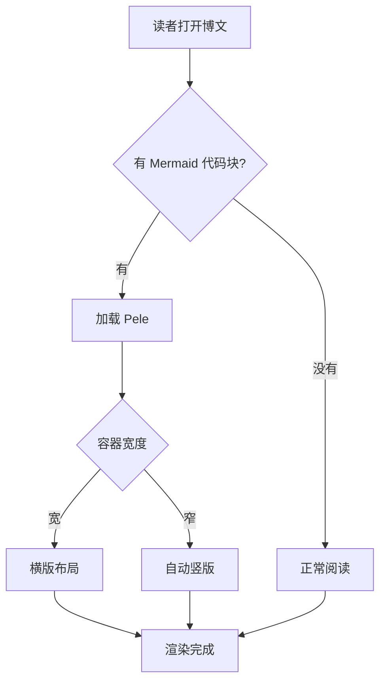
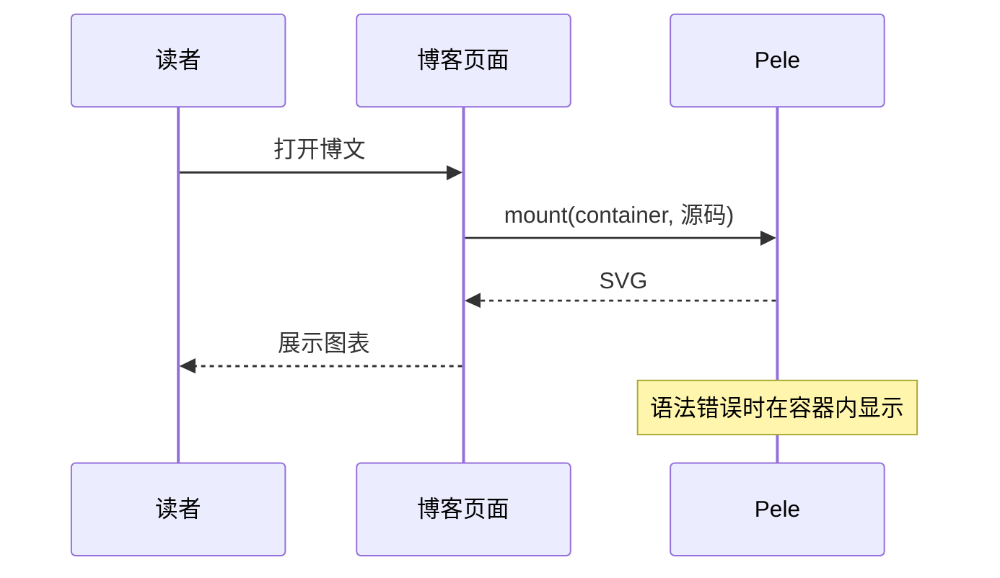
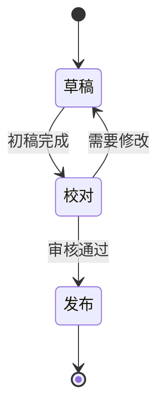
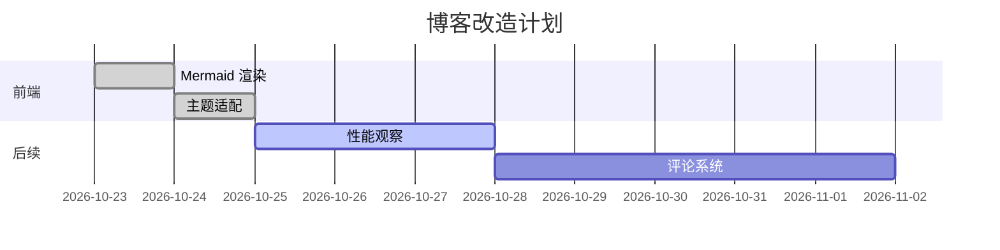
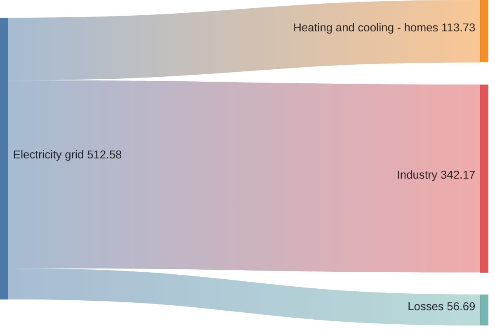
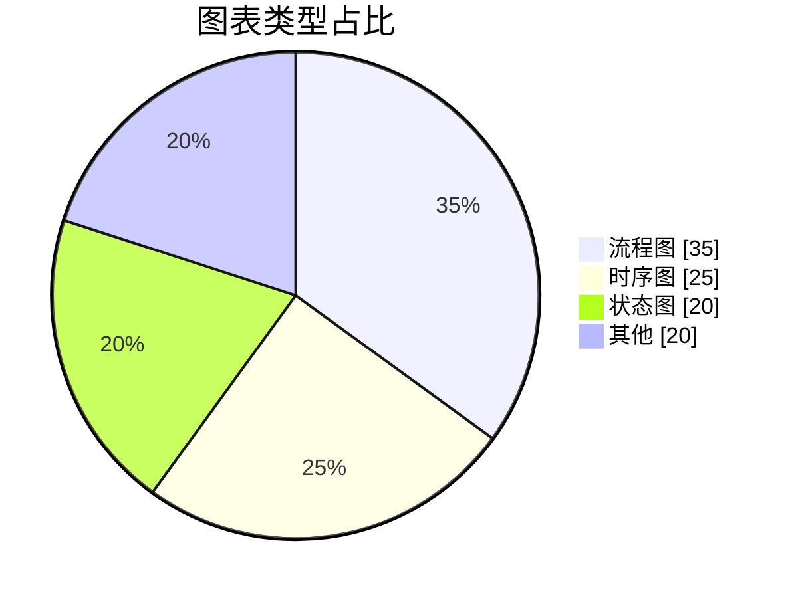
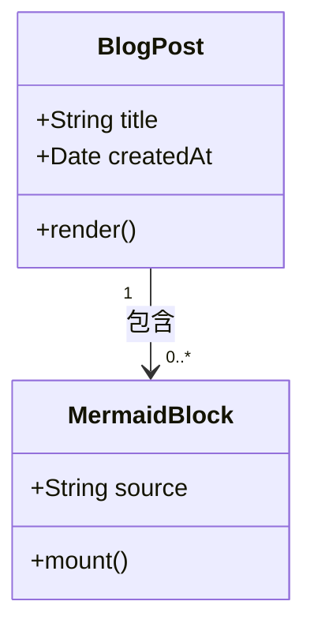
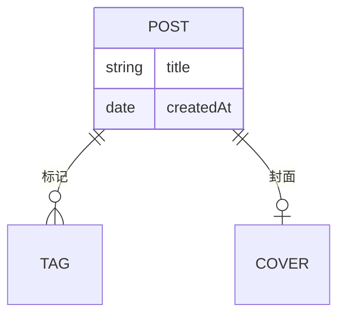

这是一篇测试博文，用来验证各类 Mermaid 图在正文中的渲染效果。以下覆盖常用图型。

## 流程图（Flowchart）

## 时序图（Sequence）

## 状态图（State）

## 甘特图（Gantt）

## 饼图（Pie）

## 类图（Class）

## 实体关系图（ER）

---

普通 Markdown 元素回归检查：**加粗**、*斜体*、`行内代码`、[链接](https://pele.run)、以及表格：

| 图型 | 状态 |
| --- | --- |
| flowchart | ✅ |
| sequence | ✅ |
| state | ✅ |
| gantt | ✅ |
| pie | ✅ |
| class / er | ✅ |
