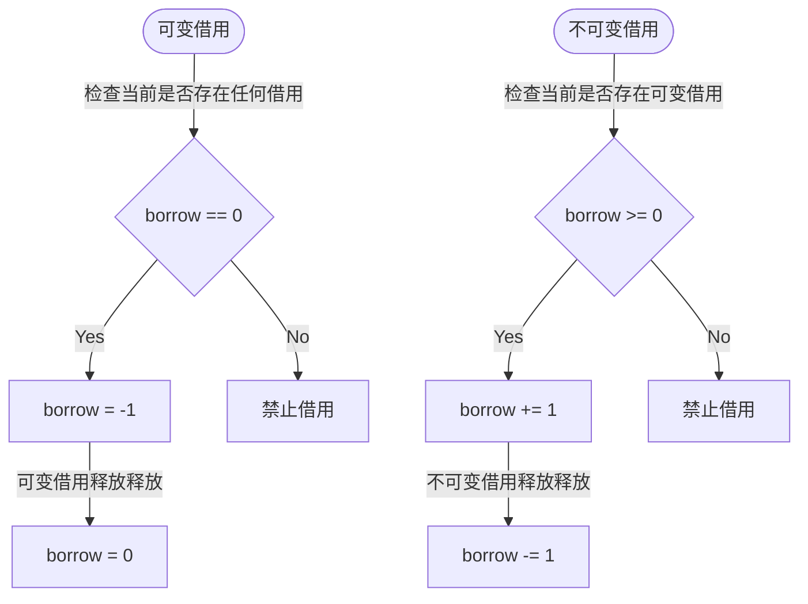

该博文主要基于哔哩哔哩视频 [BV1AYqhBQEs4](https://www.bilibili.com/video/BV1AYqhBQEs4) 及合集后面两集学习、整理而来，欢迎支持浏览原视频喵。

## Unsafe Rust

Unsafe Rust 主要提供五种能力[^superpowers]：
1. 解引用裸指针
2. 调用 Unsafe 函数和方法
3. 访问或者修改可变 static 变量
4. 实现 Unsafe trait
5. 读取 union（联合体）

### 解引用裸指针
创建裸指针方法
```rust
let mut value: i32 = 10;
// Rust 2024 之前，通过借用转换成裸指针
let r1 = &value as *const i32;
let r2 = &mut value as *mut i32;
// Rust 2024 之后，直接使用 raw 关键字创建
let r1 = &raw const i32;
let r2 = &raw mut i32;

// 其中带 const 的指向的是不可变数据指针，带 mut 指向的是可变数据指针
unsafe {
    println!("r1: {}", *r1);
    *r2 += 5;
}
```
对于裸指针：
- 裸指针可以指向任意地址，所以可能产生空指针、悬垂指针或者非法内存
- 不具有 RAII 机制，需要手动管理指向的内存
- 不进行借用检查
- 不保证多线程安全

对于更多有关裸指针操作讲解以及可能产生的问题，可以查看视频 [BV1cZBLBVEQd](https://www.bilibili.com/video/BV1cZBLBVEQd/) 08:55 - 24:50

### 调用 Unsafe 函数和方法
通常有两个场景使用 unsafe 方法：

**1).** 方法内部有 unsafe 操作（在新版 Rust 中尽管是 unsafe 方法里进行 unsafe 操作，仍需在 unsafe 块中，否则会产生警告）；
```rust
static mut NUM: i32 = 10;

unsafe fn change_static_num() {
    unsafe {
        NUM = NUM + 1;
    }
}
```
**2).** 提醒调用者要注意不安全的行为，比如标准库 String 中有一个 unsafe 方法 `from_utf8_unchecked`：
```rust
pub unsafe fn from_utf8_unchecked(bytes: Vec<u8>) -> String {
    String { vec: bytes }
}
```
其内部没有任何 unsafe 操作，但是它不检查字节是否符合 UTF-8，用户必须自己保证。

### 实现 Unsafe trait
```rust
unsafe trait Divide {
    fn div(&self, other: Self) -> Self;
}

unsafe impl Divide for i32 {
    fn div(&self, other: Self) -> Self {
        *self / other
    }
}

fn main() {
    10.div(0);
}
```

### 读取 union
Union[^union_reference] 定义跟 `struct` 语法一样，除了将 `struct` 换成 `union`：
```rust
#[repr(C)]
union MyUnion {
    i: i32,
    f: f32,
}

fn main() {
    let u = MyUnion { f: 3.14 };
    let f = unsafe { u.f };

    unsafe {
        println!("i = {}", u.i); // 1078523331 （错误的方式解释数据）
        println!("f = {}", u.f); // 3.14
    }
}
```
union 可以让不同类型的成员共享同一块内存空间，比如案例里面 `i32` 和 `f32` 的两个变量共享 4 字节空间。但是，不同数据类型对数据编解码形式不同。比如案例里，对于 `f32` 是一个 `IEEE 754` 编码的浮点类型数据，强行解析为 `i32` 的数据会产生非预期的结果，此时不安全，所以需要在 unsafe 块中进行读取。

## 型变
### 定义
在计算机科学类型系统中，型变描述复杂类型与组件类型之间的子类型关系如何传递，一共有三种：
- 协变（Covariance）：保持原有父子关系
- 逆变（Contravariance）：反转原有的父子关系
- 不变（Invariance）：子类型之间没有任何关系

所谓类型之间的关系，就如 OOP 语言中的继承关系，用 `A <: B` 表示 A 是 B 的子类型，意味着在需要父类型的位置可以传入子类型。在 Rust 中没有继承，但是生命周期标注本质是一种类型，有父子关系。其中 `'static` 是最长的生命周期，是所有生命周期的子类型。

对于型变，表示的是一对父子类型经过同样的变换之后的关系，比如说有类型 A、B，其关系为 `A <: B`，对于 `Wrapper<A> Wrapper<B>` 就有三种传递关系：如果 `Wrapper<A> <: Wrapper<B>` 我们就讲协变，关系相反则是逆变，若没关系就是不变。

在《The Rust Programming Language》[^the_book_lifetime]中，有经典示例：
```rust
fn longest<'a>(x: &'a str, y: &'a str) -> &'a str {
    if x.len() > y.len() { x } else { y }
}

fn main() {
    let string1 = String::from("Hello"); // 's1
    let result;
    {
        let string2 = String::from("xyz"); // 's2
        result = longest(string1.as_str(), string2.as_str()); // 'a = min('s1, 's2) = 's2
        //                    &'s2 str          &'s2 str
        // 's1 <: 's2
        // &'a str -> 协变
        // &'s1 str <: &'s2 str
        println!("The longest string is {result}");
    }
}
```
对于 `string1`、`string2`，假设其拥有的生命周期为 `'s1`、`'s2`，明显其关系是 `'s1 <: 's2`。之后这两个作为实参传入 `longest` 函数中，该函数签名 `'a` 会选择较小的作为最终确定的周期即这里实际为 `'s2`。如果形参的参数是 `'s2` 那根据之前说的子类型可以传入父类型，`'s1` 作为 `'s2` 的子类型，能够传入是理所当然的。可是这里 `longest` 的形参的类型实际上是 `&'s2 str`，所以这里其实是进行了转变，并且是协变，也就是这种情况下 Rust 认为 `&'s1 str <: &'s2 str`，所以能够传入。

### Rust 中常见型变规则
在 Rust 中，对于常见型变规则如下：
| 类型 | 型变规则 |
| :--- | :--- |
| `&'a T` | 在 `'a` 和 `T` 上都是协变 |
| `&'a mut T` | 在 `'a` 上协变，在 `T` 上不变 |
| `fn(T) -> U` | 在 `T` 上逆变/不变，在 `U` 上协变 |
| `UnsafeCell<T>` | 在 `T` 上不变 |
| `Cell<T>` | 在 `T` 上不变 |
| `RefCell<T>` | 在 `T` 上不变 |
---
对于结构体，如果一个泛型参数（生命周期标注也算一种泛型）在结构体中全部协变则协变、全部逆变则逆变，若有不变或者同时有逆变和协变则也不变。比如说：
```rust
struct Combo<'a, T> {
    s: &'a T,
}
```

这里面 `Combo` 中所有出现 `'a` 的位置都是协变，则若 `'a1 <: 'a2` 能推出 `Combo<'a1, T> <: Combo <'a2, T>`，这里的泛型 `T` 同理。如果改成这样：

```rust
struct Combo<'a, T> {
    s: &'a T,
    _marker: PhantomData<&'a mut T>
}
```
因为说对于 `&'a mut T` 对于 `T` 不变，则尽管 `A <: B`，我们也无法推断出 `Combo<'a, A>` 和 `Combo<'a, B>` 的关系。（当然 Rust 中没有继承，这里的类型 A、B 更多是带生命周期标注的类型比如 `MyStruct<'long> <: MyStruct<'short>`）

这里还用到了 `std::marker::PhantomData` 结构体，其放在结构体中为零大小、不占内存，但是让编译器认为该结构体拥有该类型。

## 内部可变性
内部可变性指当持有一个复合类型的不可变借用时，通常意味着不能修改这个类型。但内部可变性允许在持有不可变借用的同时，修改复合类型内部的部分字段。
### 内部可变性 + 协变
如果同时实现内部可变性 + 协变，也就是说短生命周期的数据如果能够传入需要更长生命周期地方，会有垂悬借用的风险。因为内部可用性会产生赋值，如果需要的较长生命周期数据是需要作为值储存，但传入较短生命周期数据，则会导致较短生命周期数据被释放进而导致储存的对应数据已经被释放，产生悬垂借用。

这也就是为什么对于 `&'a mut T` 对 `T` 来说不变，因为 `T` 就是改变的具体数据类型。

想要避免悬垂借用，要么选择放弃内部可变性，要么就放弃协变变成不变。Rust 实现内部可变性就是让其关系成为不变。
### UnsafeCell
之前版本的 Rust，可以通过创建不可变引用转换成不可变裸指针在转换成可变裸指针实现内部可变性，新版 Rust 禁止这种方法，需要使用 Rust 已经封装的 `UnsafeCell`，并且 `Cell` 和 `RefCell` 就是基于 `UnsafeCell` 进一步封装。

`UnsafeCell` 定义在 `std::cell::UnsafeCell`：
```rust
#[repr(transparent)]
pub struct UnsafeCell<T: ?Sized> {
    value: T,
}
```
其中 `#[repr(transparent)]` 表示让 `UnsafeCell` 内存布局与内部的 `value` 值的内存布局一致。

#### UnsafeCell::Get
对于 `UnsafeCell` 其中有一个关键方法 `UnsafeCell::get`：
```rust
pub const fn get(&self) -> *mut T {
    // We can just cast the pointer from `UnsafeCell<T>` to `T` because of
    // #[repr(transparent)]. This exploits std's special status, there is
    // no guarantee for user code that this will work in future versions of the compiler!
    self as *const UnsafeCell<T> as *const T as *mut T
}
```
它通过接收不可变借用返回可变裸指针，其为 `safe` 方法，因为它只创建了裸指针并没有使用。而且如标准库代码中注释可知，得益于 `#[repr(transparent)]`，可以直接将结构体转换成可变裸指针得到其 `value` 的可变裸指针。最后一句意思是这种实现是利用了 std 的特殊地位，对于用户代码不一定有效。
#### UnsafeCell::into_inner
```rust
pub const fn into_inner(self) -> T {
    self.value
}
```
直接拿到内部的数据，如果实现了 Copy 会复制，如果没有实现则会发生移动。
#### UnsafeCell::replace (unsafe)
```rust
pub const unsafe fn replace(
    &self, value: T
) -> T {
    ptr::replace(self.get(), value)
}
```
替换内部的数据并且返回原值。
#### UnsafeCell::get_mut
```rust
pub const fn get_mut(&mut self) -> &mut T {
    &mut self.value
}
```
返回内部值的可变借用。

综上，其通过 `get` 接口返回可变裸指针，实现了内部可变性；通过 `get_mut` 接口能够得到可变借用，这个可变借用是安全 Rust 能力，也就是说会保证可变借用期间得到 `get` 不可变借用，保护可变不共享；同时不提供获取不可变借用的接口，因为其 `get` 接收不可变借用却可能改变值，也就是不能保证不可变借用的数据一定不可变，所以不提供能够得到不可变借用的接口。

同时，`UnsafeCell` 破坏了协变，是不变类型。也就是说不会同时出现协变又实现内部可变性，避免了悬垂借用。但是因为 `get` 接口返回的是裸指针，所以是 unsafe 的。

### Cell

Cell 适用于实现了 Copy 的类型。

#### Cell::new
```rust
Cell::new(10);
```

#### Cell::get
```rust
impl<T: Copy> Cell<T> {
    pub const fn get(&self) -> T {
        // SAFETY: This can cause data races if called from a separate thread,
        // but `Cell` is `!Sync` so this won't happen.
        unsafe { *self.value.get() }
    }
}
```
直接拿到内部值的拷贝，这里是为实现了 Copy 类型实现的 get。
#### Cell::replace
```rust
pub const fn replace(&self, val: T) -> T {
    // SAFETY: This can cause data races if called from a separate thread,
    // but `Cell` is `!Sync` so this won't happen.
    mem::replace(unsafe { &mut *self.value.get() }, val)
}
```
因为 `Cell` 是安全 Rust 封装，所以使用的是 `std::mem::replace` 方法，其接收引用，可以进行生命周期检查。
#### Cell::set
```rust
pub fn set(&self, val: T) {
    self.replace(val);
}
```
`set` 调用 `replace` 替换，并且并没有把旧值返回，也就是会自动析构旧值防止内存泄露。
### RefCell
因为 `Cell` 只能实现了 `Copy` 的类型才能用 `get`，否则只能通过可变借用修改数据，所以需要持有数据不可变借用则使用 `RefCell`。`RefCell` 允许持有内部数据的不可变借用，通过运行时借用检查保证安全。
```rust
type BorrowCounter = isize;
pub struct RefCell<T: ?Sized> {
    borrow: Cell<BorrowCounter>,
    // Stores the location of the earliest currently active borrow.
    // This gets updated whenever we go from having zero borrows
    // to having a single borrow. When a borrow occurs, this gets included
    // in the generated `BorrowError`/`BorrowMutError`
    #[cfg(feature = "debug_refcell")]
    borrowed_at: Cell<Option<&'static crate::panic::Location<'static>>>,
    value: UnsafeCell<T>,
}
```
- `borrow`：引用计数器，维护借用状态
- `borrowed_at`：记录第一次借用位置，方便错误定位
- `value`：实际存储数据

对于 `RefCell` 的借用计数规则：

`borrow` 表示当前有多少个不可变借用，其中 `-1` 表示有可变借用。

#### 创建不可变借用
调用 `RefCell` 的 `borrow` 方法，能够获得一个不可变引用 `Ref`：
```rust
fn main() {
    let rc: RefCell<&str> = RefCell::new("hello");
    let r : Ref<'_, &str> = rc.borrow(); // 相当于调用 try_borrow，但是借用失败直接 panic
    let r = rc.try_borrow(); // 返回 Result，如果借用失败返回 Err，否则返回 Ok
}
```
其中 `Ref` 定义如下：
```rust
pub struct Ref<'b, T: ?Sized + 'b> {
    // NB: we use a pointer instead of `&'b T` to avoid `noalias` violations, because a
    // `Ref` argument doesn't hold immutability for its whole scope, only until it drops.
    // `NonNull` is also covariant over `T`, just like we would have with `&T`.
    value: NonNull<T>,
    borrow: BorrowRef<'b>,
}
```
`value` 是一个 `NonNull` 结构体，该结构体存储了一个指向数据的裸指针。另一个字段是 `BorrowRef` 借用，是对 `Cell<BorrowCounter>` 的借用，这个借用指向的就是 `RefCell` 里面的 `borrow`。这个 `BorrowRef` 是整个引用计数实现的核心。

```rust
struct BorrowRef<'b> {
    borrow: &'b Cell<BorrowCounter>,
}

impl<'b> BorrowRef<'b> {
    const fn new(borrow: &'b Cell<BorrowCounter>) -> Option<BorrowRef<'b>> {
        let b = borrow.get().wrapping_add(1);
        if !is_reading(b) {
            // Incrementing borrow can result in a non-reading value (<= 0) in these cases:
            // 1. It was < 0, i.e. there are writing borrows, so we can't allow a read borrow
            //    due to Rust's reference aliasing rules
            // 2. It was isize::MAX (the max amount of reading borrows) and it overflowed
            //    into isize::MIN (the max amount of writing borrows) so we can't allow
            //    an additional read borrow because isize can't represent so many read borrows
            //    (this can only happen if you mem::forget more than a small constant amount of
            //    `Ref`s, which is not good practice)
            None
        } else {
            // Incrementing borrow can result in a reading value (> 0) in these cases:
            // 1. It was = 0, i.e. it wasn't borrowed, and we are taking the first read borrow
            // 2. It was > 0 and < isize::MAX, i.e. there were read borrows, and isize
            //    is large enough to represent having one more read borrow
            borrow.replace(b);
            Some(BorrowRef { borrow })
        }
    }
}

impl const Drop for BorrowRef<'_> {
    fn drop(&mut self) {
        let borrow = self.borrow.get();
        debug_assert!(is_reading(borrow));
        self.borrow.replace(borrow - 1);
    }
}

```

对于 `BorrowRef`，`new` 方法需要传入 `Cell<BorrowCounter>` 的引用，返回 `Option<BorrowRef<'b>>`。如果是 `None` 表示创建借用失败，如果是 `Some` 则返回创建成功的借用。首先 `b` 是原本引用计数器加一，之后进行比较。`is_reading(b)` 等价成 (b > 0)。如果原本计数器值是 `-1`，加一之后是 `0`，则进入上一个分支，代表已经有可变借用就不可以再借不可变借用，否则更新计数器值并且返回可变借用。之后其通过超出作用域 Rust 自动调用析构在 `drop` 中实现计数器减一，相当于实现了 RAII 机制。

基于上面，则 `try_borrow` 方法就很简单了。调用 `BorrowRef::new`，如果返回 `Some` 则能够创建不可变借用即返回 `Ok`；返回 `None` 则无法创建不可变借用即返回 `Err`。`borrow` 则是对 `try_borrow` 进一步封装，返回 `Err` 时直接 panic。

```rust
pub const fn borrow(&self) -> Ref<'_, T> {
    match self.try_borrow() {
        Ok(b) => b,
        Err(err) => panic_already_mutably_borrowed(err),
    }
}

pub const fn try_borrow(&self) -> Result<Ref<'_, T>, BorrowError> {
    match BorrowRef::new(&self.borrow) {
        Some(b) => {
            #[cfg(feature = "debug_refcell")]
            {
                // `borrowed_at` is always the *first* active borrow
                if b.borrow.get() == 1 {
                    self.borrowed_at.replace(Some(crate::panic::Location::caller()));
                }
            }

            // SAFETY: `BorrowRef` ensures that there is only immutable access
            // to the value while borrowed.
            let value = unsafe { NonNull::new_unchecked(self.value.get()) };
            Ok(Ref { value, borrow: b })
        }
        None => Err(BorrowError {
            // If a borrow occurred, then we must already have an outstanding borrow,
            // so `borrowed_at` will be `Some`
            #[cfg(feature = "debug_refcell")]
            location: self.borrowed_at.get().unwrap(),
        }),
    }
}
```
#### 创建可变借用
调用 `RefCell` 的 `borrow` 方法，能够获得一个不可变引用 `Ref`：
```rust
fn main() {
    let rc: RefCell<&str> = RefCell::new("hello");
    let r: RefMut<'_, &str> = rc.borrow_mut(); // 相当于调用 try_borrow_mut，但是借用失败直接 panic
    let r = rc.try_borrow_mut(); // 返回 Result，如果借用失败返回 Err，否则返回 Ok
}
```
```rust
pub struct RefMut<'b, T: ?Sized + 'b> {
    // NB: we use a pointer instead of `&'b mut T` to avoid `noalias` violations, because a
    // `RefMut` argument doesn't hold exclusivity for its whole scope, only until it drops.
    value: NonNull<T>,
    borrow: BorrowRefMut<'b>,
    // `NonNull` is covariant over `T`, so we need to reintroduce invariance.
    marker: PhantomData<&'b mut T>,
}
```
`value` 一样用于存储数据，`borrow` 一样维护引用计数器，第三个 `marker` 就是之前讲解过的 `PhantomData`，让 `T` 变成不变类型。`BorrowRefMut` 的底层实现也很简单：
```rust
struct BorrowRefMut<'b> {
    borrow: &'b Cell<BorrowCounter>,
}

impl const Drop for BorrowRefMut<'_> {
    fn drop(&mut self) {
        let borrow = self.borrow.get();
        debug_assert!(is_writing(borrow));
        self.borrow.replace(borrow + 1);
    }
}

impl<'b> BorrowRefMut<'b> {
    const fn new(borrow: &'b Cell<BorrowCounter>) -> Option<BorrowRefMut<'b>> {
        // NOTE: Unlike BorrowRefMut::clone, new is called to create the initial
        // mutable reference, and so there must currently be no existing
        // references. Thus, while clone increments the mutable refcount, here
        // we explicitly only allow going from UNUSED to UNUSED - 1.
        match borrow.get() {
            UNUSED => {
                borrow.replace(UNUSED - 1);
                Some(BorrowRefMut { borrow })
            }
            _ => None,
        }
    }
}
```

`UNUSED` 是 `0`，也就是匹配到这个分支表示不存在任何借用，因此可以创建可变借用。实现 RAII 机制一样通过在 `drop` 函数中将维护的计数器加一。
```rust
pub const fn borrow_mut(&self) -> RefMut<'_, T> {
    match self.try_borrow_mut() {
        Ok(b) => b,
        Err(err) => panic_already_borrowed(err),
    }
}

pub const fn try_borrow_mut(&self) -> Result<RefMut<'_, T>, BorrowMutError> {
    match BorrowRefMut::new(&self.borrow) {
        Some(b) => {
            #[cfg(feature = "debug_refcell")]
            {
                self.borrowed_at.replace(Some(crate::panic::Location::caller()));
            }

            // SAFETY: `BorrowRefMut` guarantees unique access.
            let value = unsafe { NonNull::new_unchecked(self.value.get()) };
            Ok(RefMut { value, borrow: b, marker: PhantomData })
        }
        None => Err(BorrowMutError {
            // If a borrow occurred, then we must already have an outstanding borrow,
            // so `borrowed_at` will be `Some`
            #[cfg(feature = "debug_refcell")]
            location: self.borrowed_at.get().unwrap(),
        }),
    }
}
```

`try_borrow_mut` 和 `borrow_mut` 跟不可变借用很相似，就不再额外说明了。

> [!no-indent]
> 版权声明：本文中所引用的 Rust 标准库源码版权归属 Rust 项目开发者。基于 MIT 和 Apache 2.0 双重许可协议开源。其中删除了一些额外的不影响主要理解的注释和形如 #[] 的属性。


[^superpowers]: 见 Rust Book「Unsafe Rust」章节：<https://doc.rust-lang.org/book/ch20-01-unsafe-rust.html#performing-unsafe-superpowers>
[^union_reference]: <https://doc.rust-lang.org/reference/items/unions.html>
[^the_book_lifetime]: 见 Rust Book 中对于 lifetime 讲解：<https://doc.rust-lang.org/book/ch10-03-lifetime-syntax.html#validating-references-with-lifetimes>
